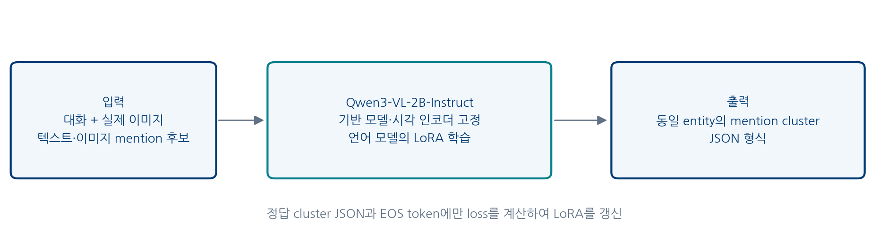

# 모델 구성과 사용 범위

Qwen/Qwen3-VL-2B-Instruct를 기반으로 패션 상담 대화의 Text–Image 상호참조 군집을 생성한다. 기반 모델 revision은 `89644892e4d85e24eaac8bacfd4f463576704203`이다. 언어 모델의 LoRA만 학습하며 시각 인코더와 visual merger는 고정한다.

입력은 대화·실제 이미지·멘션 목록이고, 출력은 멘션 ID 군집 JSON이다. 기반 모델과 학습된 adapter 가중치는 저장소에 포함하지 않는다. 사용자는 공개 기반 모델을 내려받아 포함된 데이터로 adapter를 학습할 수 있다.

학습 대상은 주어진 멘션들의 연결이다. 멘션 검출, 다른 도메인, 더 긴 대화 조건의 성능은 이번 실험으로 검증하지 않았다. 한정된 문맥과 하나의 학습 seed에 대한 결과이므로 실제 적용 조건의 추가 평가가 필요하다.

모델 카드와 라이선스: [Qwen3-VL-2B-Instruct](https://huggingface.co/Qwen/Qwen3-VL-2B-Instruct). 코드의 라이선스와 기반 모델·데이터·이미지의 이용 조건은 구분하여 확인한다.
